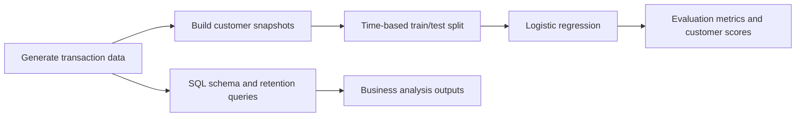

# Customer Retention Analytics and Repeat-Purchase Prediction


A portfolio project focused on **customer retention**. It combines SQL cohort and RFM analysis with a time-aware machine-learning model that estimates whether a customer will place a completed order in the next 90 days.

The included data is fictional and generated deterministically for a runnable demonstration. It is not evidence of real business performance. Replace it with an appropriately licensed transaction dataset before making real-world claims.

## Business questions

- What share of monthly revenue comes from returning customers?
- How does repeat activity change across acquisition cohorts?
- Which customers appear active, developing, or at risk based on RFM signals?
- Can recent customer behavior help prioritize customers likely to purchase in the next 90 days?
- How do product categories vary across regions?

## Project workflow



## What it demonstrates

### Analytics

- Relational schema with customer, product, order, and order-line tables
- Revenue and profit calculations at order-line level
- Monthly category and customer summaries
- SQL first-purchase cohorts, returning-customer trends, RFM-style segments, and regional category mix
- Data outputs saved as CSV for review or visualization in Excel, Power BI, or Tableau

### Machine learning

The model creates monthly customer snapshots. At each snapshot date it uses only the previous 180 days of behavior to predict at least one completed purchase in the following 90 days. Features include recent order count, spend, average order value, recency, category-order breadth, customer region, and segment.

The latest six snapshot months are held out as a forward-in-time test set. A logistic regression pipeline imputes missing values, scales numeric fields, one-hot encodes categories, and uses class weighting. Evaluation reports ROC-AUC, average precision, Brier score, precision, and recall. These metrics answer different questions; use average precision and calibration alongside ROC-AUC when the positive class is uncommon.

The output scores are prioritization signals for a fictional dataset, not causal evidence that an intervention will increase retention. The threshold of 0.5 is a default for reporting and should be chosen against campaign capacity and intervention costs in a real deployment.

## Repository structure

```text
ecommerce-customer-analytics-ml/
├── data/                         # Generated CSV inputs (created by script)
├── outputs/                      # Analysis tables, model metrics, and scores
├── sql/
│   ├── schema.sql                # MySQL 8 table definitions
│   └── retention_analysis.sql    # Cohort, RFM, and regional analyses
├── src/
│   ├── generate_data.py          # Reproducible fictional dataset generator
│   └── run_project.py            # Analytics pipeline and ML evaluation
├── requirements.txt
└── README.md
```

## Run locally

Requires Python 3.10 or newer.

```bash
cd ecommerce-customer-analytics-ml
python -m venv .venv
```

Activate the environment (`.venv\Scripts\Activate.ps1` in PowerShell, or `source .venv/bin/activate` on macOS/Linux), then:

```bash
python -m pip install -r requirements.txt
python src/generate_data.py
python src/run_project.py
```

Generated input CSVs are written to `data/`; project outputs appear in `outputs/`. The SQL files are provided for loading the same CSV tables into MySQL 8 and running the database-side analyses. Create the tables with `sql/schema.sql`, import the four CSVs using your preferred MySQL client, then execute `sql/retention_analysis.sql`.

## Outputs

- `monthly_retention_context.csv` — monthly revenue, active customers, orders, and revenue per order
- `category_performance.csv` — category revenue, units, profit, and margin
- `customer_retention_summary.csv` — customer-level completed-order summaries
- `model_snapshot_features.csv` — time-indexed model features and outcomes
- `model_metrics.csv` — forward-test evaluation metrics
- `latest_customer_scores.csv` — latest 90-day repurchase probabilities

## Resume bullets (edit with measured results)

- Built a customer-retention analytics pipeline using Python, pandas, and MySQL, including cohort analysis, RFM-style segmentation, and category performance reporting.
- Engineered leakage-aware 180-day behavioral features and trained a logistic regression model to estimate 90-day repeat-purchase probability using a chronological holdout.
- Evaluated ranking and probability quality with ROC-AUC, average precision, and Brier score; generated customer-level scores to support retention campaign prioritization.

Replace vague claims with actual metric values from `outputs/model_metrics.csv` after running the project. Do not claim the fictional data reflects real customer or business outcomes.

## Next steps

For a stronger applied portfolio version, replace the generated data with a licensed retail dataset, document the data source, rerun the pipeline, add a business-facing dashboard, and compare logistic regression against a tree-based baseline using the same chronological split.
